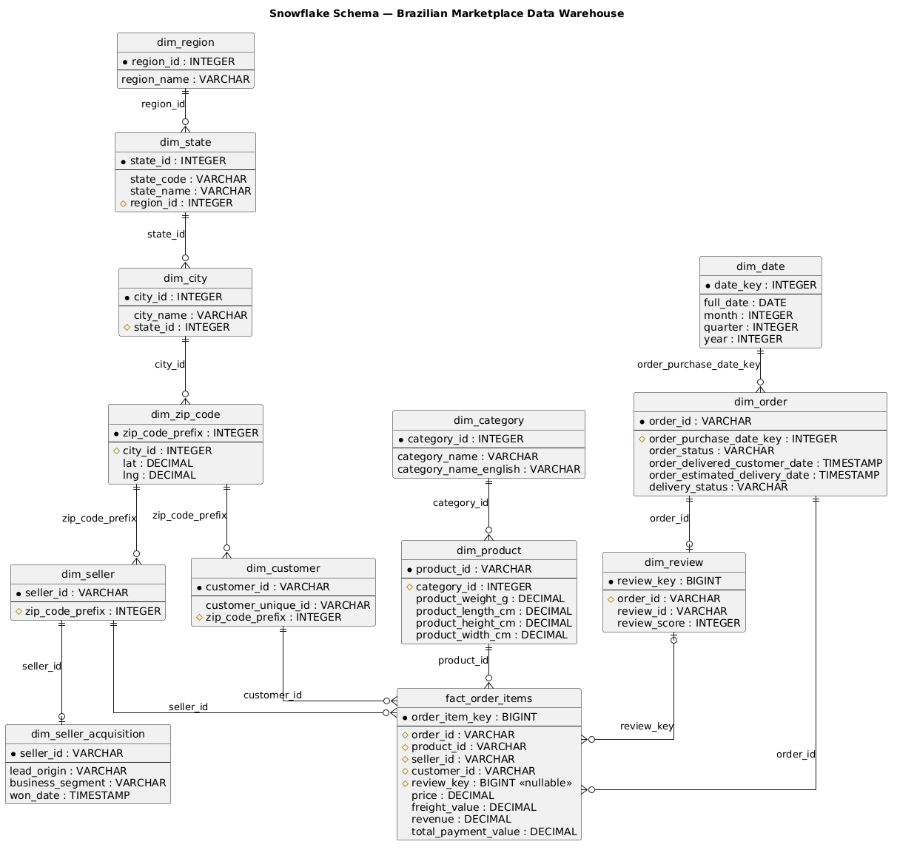

Data Analytics 1 — Assignment 2

Part 1: Data Warehousing — Brazilian E-Commerce (Olist) Dataset

## 1. Overview

This report covers the design, construction, and analysis of a Snowflake Schema data warehouse built from the Olist Brazilian e-commerce dataset (11 source CSVs) using DuckDB. It summarises the ETL procedure, the dimensional hierarchies normalised, and the key insights drawn from the 10 analytical queries in Task 3.

## 2. Data Preprocessing and Cleaning

Before any schema or ETL work, the 11 raw CSVs were profiled for data quality issues, and every cleaning decision below is tied either to a measured profiling result or a stated requirement, such as not dropping orders or products just because a field is missing.

- Fixed a byte-order-mark (BOM) on categories.csv's header, which silently broke the join between products and their category translations.

- geolocation.csv contained 128,174 exact duplicate rows and ~50 raw rows per zip code prefix on average (1,000,163 rows for only 19,015 distinct prefixes). These were aggregated to one row per prefix, using averaged latitude/longitude and the most frequent (modal) city/state.

- City names carried casing inconsistencies and encoding corruption across customer, seller, and geolocation files (e.g. 'sao paulo', 'SÃO PAULO', and a mangled 'sa£o paulo'). All city names were lowercased, trimmed, and had accents/mis-encoded characters stripped, preventing fragmented groupings in geography roll-ups.

- 610 products had a NULL product_category_name; these were bucketed under a placeholder 'unknown_category' rather than dropped, to avoid silently excluding orders or products from the warehouse.

- 2,965 orders had a NULL delivery date and 768 had no matching review; both were explicitly preserved (via LEFT JOINs at load time) rather than dropped, since an order that hasn't been delivered yet or hasn't been reviewed yet is still a real order.

- order_payments.csv and order_reviews.csv both contained multiple rows per order (split payments; re-submitted reviews). These were aggregated/deduplicated to one row per order before loading, preventing fan-out duplication in the fact table.

- A cross-file consistency pass (after per-file cleaning) found 165 zip code prefixes referenced by customers/sellers but absent from geolocation.csv, and 2 product categories ('pc_gamer', 'portateis_cozinha_e_preparadores_de_alimentos') present in products.csv but missing from the category-translation file entirely. Both gaps were patched into the cleaned files so no customer, seller, or product was orphaned at load time.

## 3. Schema Design

A Snowflake Schema was chosen so that each dimension hierarchy could be normalised into its own level tables, avoiding repeated attribute redundancy and keeping each hierarchy's grain explicit.

Fact table grain: one row per order item

(i.e. one row per product line within an order, matching the grain of order_items.csv, since price and freight are recorded per item rather than per order).

### 3.1 Hierarchies Normalised

- Geography (region → state → city → zip code prefix): shared by both dim_customer and dim_seller through a common zip-code dimension. The region level does not exist in the raw data; it was derived by mapping each of Brazil's 27 states to one of the 5 official IBGE macro-regions (North, Northeast, Central-West, Southeast, South). Normalising this hierarchy allows revenue to be rolled up or drilled down at any geographic granularity without re-aggregating from raw rows each time.

- Product (category → product, with English translation): separating dim_category from dim_product avoids repeating the category name and its English translation on every one of the 32,951 product rows, and lets category-level revenue be computed directly from a small lookup table.

- Seller (seller → acquisition details): dim_seller_acquisition holds lead origin, business segment, and won date separately from dim_seller, since acquisition data only exists for the subset of sellers recruited through the tracked marketing funnel (380 of 3,095 sellers) — normalising this out avoids forcing every seller row to carry mostly-empty acquisition columns.

### 3.2 ER Diagram (Explicit Cardinality Labels)

## 4. ETL Process

Data was loaded strictly top-down so every foreign key resolved before being referenced:

- 1. dim_region (derived state-to-region seed mapping)

- 2. dim_state (joined to region)

- 3. dim_city (union of cities seen across geolocation, customers, and sellers)

- 4. dim_zip_code (from patched geolocation data)

- 5. dim_category (from patched category-translation data)

- 6. dim_product (joined to category)

- 7. dim_seller and dim_seller_acquisition

- 8. dim_customer

- 9. dim_date (generated from the full date range spanning all orders)

- 10. dim_order (delivery_status derived here as early/on_time/late, or NULL for undelivered orders)

- 11. dim_review (given a surrogate key, since review_id is reused across ~561 different orders in the raw data and cannot serve as a primary key on its own)

- 12. fact_order_items (order_items LEFT JOINed to payments and reviews, so orders missing either are preserved rather than dropped)

Post-load verification confirmed all 112,650 order-item rows loaded with zero orphaned foreign keys, and that rows with no review (942), no payment (3), and undelivered status (2,454) were correctly retained rather than lost.

## 5. Key Insights from Analysis

Geographic concentration: the Southeast region generates $12.43M of the $15.84M total revenue (78.4%), driven overwhelmingly by the state of São Paulo, whose capital city alone (São Paulo) accounts for over $3.2M. The South region follows a distant second at 16.8%, while the North region contributes under 0.1%.

Category leadership: health_beauty is the top revenue-generating category overall ($1.44M, 9.1% of total revenue), narrowly ahead of watches_gifts ($1.31M) and bed_bath_table ($1.24M). Within the Southeast region specifically, watches_gifts (relogios_presentes) is the top category at $1.20M — showing that regional category leaders can differ from the national leader.

Delivery timing strongly predicts satisfaction: orders delivered early average a 4.29 review score (88,168 orders), on-time deliveries average 4.03 (1,280 orders), while late deliveries average only 2.27 (6,382 orders) — a drop of roughly 2 full points, making delivery punctuality one of the strongest observed predictors of customer satisfaction in this dataset.

Revenue growth: total revenue grew from $57K (2016, partial year) to $7.14M (2017) to $8.64M (2018, partial year), indicating strong year-over-year growth; November 2017 was the single highest-revenue month ($1.18M).

Seller acquisition channels: excluding the 'unknown' origin (a data gap where lead records could not be matched to closed deals), organic_search recruited the highest-revenue sellers ($235,957 across 113 sellers), narrowly ahead of paid_search ($182,000 across 101 sellers) — suggesting organic channels attract sellers with comparable per-seller revenue at lower acquisition cost.

Customer concentration: the top 5 customers by total purchase amount range from $6,922 to $13,664 — individually small relative to the $15.84M total, indicating revenue is broad-based across many customers rather than concentrated in a few large buyers.

## 6. Data Quality Notes

Two categories of "missing" data were deliberately handled differently and should not be conflated:

- unknown_category (610 products, $207,705.09 revenue) is a placeholder for products with no category assigned in the source data. It is retained and explicitly labelled in Q3 and Q4 so totals reconcile to the warehouse grand total; it should be interpreted as missing source metadata rather than as a coherent product category.

- Categories such as pc_gamer have a genuine Portuguese category name but no English translation in categories.csv. These are retained in all category-level analysis, falling back to the Portuguese name for display.

## 7. Conclusion

The Snowflake Schema, ETL pipeline, and OLAP queries built here collectively demonstrate a complete, verifiable path from raw, imperfect source data to a queryable warehouse. Every cleaning decision was grounded in either a measured data-quality issue or a stated requirement, and every load-time gap (missing zip codes, missing category translations, non-unique review IDs) was surfaced through testing and resolved deliberately rather than silently. The resulting analysis surfaces clear, quantifiable business insights — most notably the dominance of the Southeast region and the strong link between delivery punctuality and customer satisfaction.
