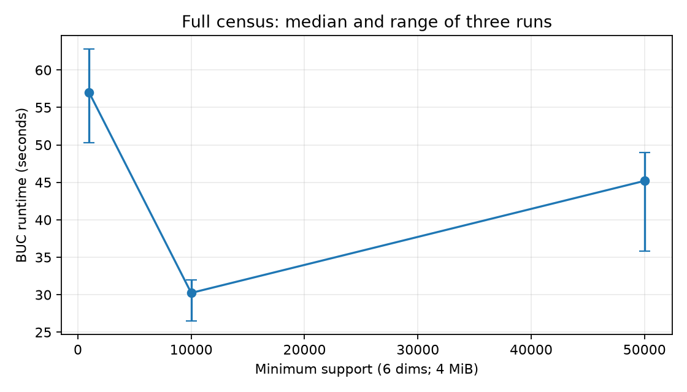
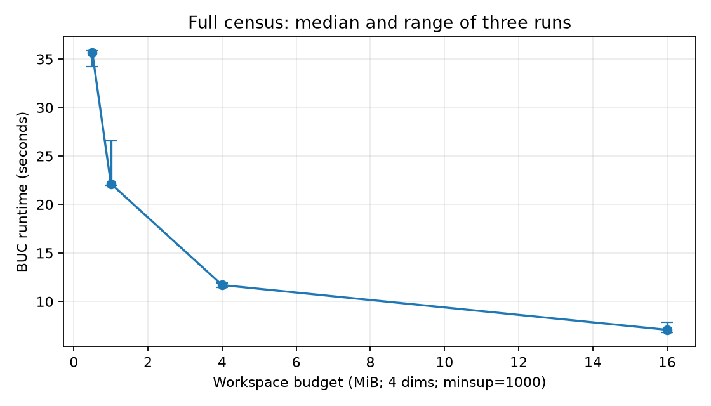
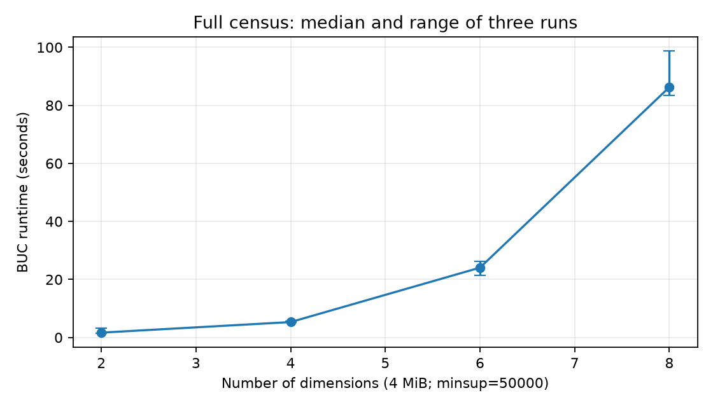
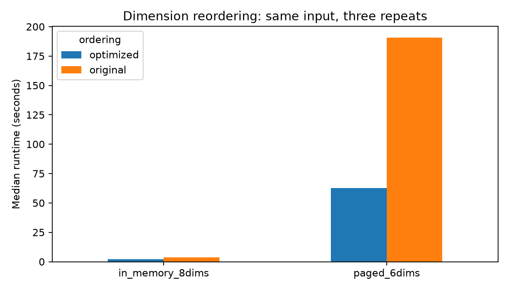

M26 Data Analytics 1 — Assignment 2

Part 2: Attribute-Oriented Induction and the BUC Algorithm

## 1. Introduction

This report covers Part 2 of Assignment 2: extracting interesting cubes from a large census dataset using the BUC algorithm, and characterizing the data using Attribute-Oriented Induction (AOI). The dataset consists of 299,285 rows and 42 mostly-categorical columns of U.S. census survey data, with income (>$50K vs. <=$50K) as the class label.

Every decision described below — from how missing values were treated, to which attributes became BUC dimensions, to the thresholds used in AOI, to the optimization technique — was made after profiling the actual data rather than assuming its properties. Where profiling produced a surprise (duplicate rows, non-strict hierarchy mappings, a weak minsup effect at low dimensionality), that surprise and how it was resolved is documented rather than smoothed over.

## 2. Dataset Overview and Profiling

The raw dataset has 299,285 rows and 42 columns. The class label, income, is heavily imbalanced: 280,717 rows (93.8%) are <=$50K and 18,568 rows (6.2%) are >$50K. This imbalance matters for AOI's t-weight/d-weight interpretation and was kept in mind throughout rather than corrected for, since the task is descriptive characterization, not classification.

Two structural properties of the data shaped every downstream decision:

- "?" and "Not in universe" are valid categorical values in census microdata (structural non-response / the question did not apply to that respondent), not nulls to impute. Columns like migration_msa and migration_reg are 50% "?"; enrolled_in_edu_last_wk is 93.7% "Not in universe". Both were kept as explicit categories throughout.

- Four hierarchy pairs already exist in the data as detailed/summary column pairs: industry, occupation, household, and region/state of previous residence. These were used both as raw material for building concept hierarchies and as a way to validate the hierarchy-generalization logic against ground truth.

## 3. Data Cleaning and Preprocessing

Unlike Part 1's raw marketplace CSVs, this dataset had no corruption, encoding, or formatting issues — no BOM characters, no casing inconsistencies, no stray whitespace. Cleaning here consisted of two explicit decisions, both tied to profiling results rather than assumed:

### 3.1 No deduplication

6,735 rows are exact duplicates of another row. These were checked and found to be legitimate: with 42 mostly-categorical, low-cardinality columns, structurally similar respondents (e.g. infants: age=0, most fields "Not in universe") produce identical rows by chance. Each row is one census respondent, so dropping "duplicates" would mean discarding real people. This is the opposite conclusion to Part 1, where a row was one order and duplicate payment/review rows did need collapsing to prevent fact-table fan-out — same instinct, opposite outcome, because the grain differs.

### 3.2 hispanic_origin null handling

This is the only column with true (NaN) nulls: 1,279 rows (0.43%), distinct from the existing "Do not know" category (446 rows). These were filled with an explicit "Not Reported" label rather than merged into "Do not know", since conflating "chose not to know" with "did not answer" would muddy AOI's generalization for this attribute.

### 3.3 Dimension selection

15 columns were selected as the working dimension pool for the rest of Part 2, comfortably above the 12-column minimum for BUC dimensions. instance_weight was excluded from the dimension set since it's a sampling weight, not a feature, but it was kept in the cleaned dataset as a candidate secondary measure for BUC (SUM(instance_weight) is the textbook-correct population-weighted count for a census sampling weight).

| Dimension | Categories | Role |
| --- | --- | --- |
| age | 91 (single years) | BUC dimension; AOI generalizes via age_hierarchy |
| education | 17 | BUC dimension; AOI generalizes via education_hierarchy |
| class_of_worker | 9 | BUC dimension |
| marital_status | 7 | BUC dimension |
| race | 5 | BUC dimension |
| sex | 2 | BUC dimension |
| hispanic_origin | 10 (incl. Not Reported) | BUC dimension |
| industry_code_major | 24 | BUC dimension (detailed variant used for AOI) |
| occupation_code_major | 15 | BUC dimension (detailed variant used for AOI) |
| household_summary | 8 | BUC dimension (detailed variant used for AOI) |
| region_prev_residence | 6 | BUC dimension (detailed variant used for AOI) |
| tax_filer_status | 6 | BUC dimension |
| citizenship | 5 | BUC dimension |
| employment_status | 8 | BUC dimension |
| year | 2 (94, 95) | BUC dimension |

Every categorical dimension was label-encoded to a small integer code (saved in category_encodings.json) for the array-based BUC implementation. income was mapped to a clean binary income_flag (1 = ">50K"). The cleaning script validated itself before saving output: row count preserved (299,285 in, 299,285 out), income_flag positive-class count matched the raw profiling exactly (18,568), and every encoded column's code count matched its raw cardinality.

## 4. Concept Hierarchy Construction

Six concept hierarchies are submitted as data under hierarchies/: a JSON definition manifest plus authored age and education mapping CSVs. The four dataset-provided detailed/summary pairs are materialized as validated mapping CSVs by Build_hierarchies.py. This exceeds the requirement of at least five and avoids hardcoded AOI generalization logic. Four are derived directly from the dataset's own detailed/summary column pairs; two (age, education) were authored, since no natural roll-up column exists for them in the source data.

The two authored hierarchies use bands chosen for real-world meaning rather than even splits of the value range:

- **Age** collapses 91 single-year values into 7 bands: Child (0-17), Young Adult (18-24), Adult (25-34/35-44/45-54/55-64), Senior (65+). These follow labour-market and life-stage boundaries that are actually relevant to an income label — under 18 is legally not in the workforce, 18-24 covers the early-career/still-studying years where income is depressed regardless of ability, the 25-64 range is split into decade bands since income typically rises with career progression within working age, and 65+ marks the standard US retirement threshold where income composition shifts to pensions/social security. An even 10-year split with no regard for these boundaries (e.g. 20-29, 30-39) would have mixed students in with early-career workers inside the same band.

- **Education** collapses 17 raw categories into 7 tiers (Not Applicable, Below High School, Some High School, High School Graduate, Some College/Associate, Bachelor's Degree, Advanced Degree) that match the credential boundaries the US labour market actually prices differently — a diploma, an associate degree, a bachelor's, and a graduate/professional degree are each a distinct, commonly-cited threshold in income studies, so collapsing "Masters" and "Doctorate" together (both under Advanced Degree) loses less relevant distinction than, say, splitting "9th grade" from "10th grade" would have gained.

| Hierarchy | Level 0 → Level 1 → Level 2 | Source |
| --- | --- | --- |
| industry | industry_code_detailed (52) → industry_code_major (24) → ANY | Derived from data |
| occupation | occupation_code_detailed (47) → occupation_code_major (15) → ANY | Derived from data |
| household | household_family_status (38) → household_summary (8) → ANY | Derived from data |
| geography | state_prev_residence (51) → region_prev_residence (6) → ANY | Derived from data |
| age | single year (91) → age band (7) → ANY | Authored |
| education | 17 categories → education tier (7) → ANY | Authored |

### 4.1 Validating the derived hierarchies against ground truth

Before trusting the four derived hierarchies, each detailed→summary mapping was checked for whether it is a clean roll-up (every detailed value maps to exactly one summary value). Two were not:

- household_family_status = "In group quarters" maps to 7 different household_summary values (187 of 279 rows are "Group Quarters- Secondary individual"; the rest split across Householder, Spouse, Child, etc.) — group-quarters residents get further split by role even though the detailed label does not capture that.

- state_prev_residence: '?' maps to both "Northeast" (648 rows) and "South" (390 rows); 'Abroad' mostly maps to "Abroad" (733 rows) but sometimes to "West" (203 rows).

Each was resolved with the majority mapping, and the exception was logged (hierarchy_exceptions.json) rather than silently hidden — this is a genuine data-quality finding, not an error to be papered over.

## 5. Attribute-Oriented Induction

AOI was implemented as the classic two-threshold algorithm (Han, Kamber & Pei):

- Attribute generalization threshold (default 5, overridden to 7 for age and education, since their hierarchies were specifically built to land meaningfully at the band/tier level): if an attribute still has more distinct values than its threshold, generalize it one level up its concept hierarchy, or remove it entirely if no hierarchy exists.

- Relation generalization threshold (350): after every attribute individually satisfies its own threshold, if the merged relation still has more distinct tuples than this, the attribute with the most remaining distinct values is generalized further (or removed), and tuples are re-merged.

For the four hierarchies derived from real detailed/summary pairs, AOI uses the DETAILED-level column (e.g. industry_code_detailed) rather than the major/summary column used as the BUC dimension — this lets AOI actually walk the full 3-level hierarchy (detailed → major → ANY) instead of starting one level up with only a trivial "collapse to ANY" step available.

### 5.1 Generalization outcome

After the per-attribute pass, 9 of 13 attributes were retained (4 were removed outright — class_of_worker, marital_status, tax_filer_status, employment_status — for exceeding their threshold with no hierarchy to fall back on); the relation still had 1,486 distinct tuples. The relation-threshold pass then collapsed age (tied with education for the most remaining distinct values, and picked first) to ANY, bringing the relation down to 328 distinct tuples over the two attributes that mattered most for discriminating income: education_tier, race, sex, and citizenship.

A deliberate first attempt used a stricter relation threshold (60), which forced both age and education to collapse to ANY — destroying the two hierarchies specifically built to demonstrate multi-level generalization. Loosening the threshold to 350 was a direct fix to preserve education's granularity, and is documented here rather than silently corrected, since it illustrates a genuine trade-off in the algorithm: a tight relation threshold can eliminate exactly the attributes an analyst most wants to keep.

### 5.2 Characteristic and discriminant rules

t-weight (characteristic rule, target = income >$50K) is the percentage of the target class covered by a generalized tuple. d-weight (discriminant rule) is the percentage of matching records that belong to the target class. AOI.py exports the complete weighted relation and separate top-10 characteristic and discriminant rule tables under cleaned/aoi/.

The discriminant rules validate the pipeline on their own: d-weight rises monotonically with education tier — Advanced Degree 52%, Bachelor's Degree 32%, Some College/Associate 13%, High School Graduate 8% — exactly the direction expected, and a strong sign the generalization and weight computation are both correct rather than producing plausible-looking noise.

## 6. BUC Algorithm — In-Memory Implementation

BUC (Beyer & Ramakrishnan, 1999) computes the iceberg cube: every dimension-combination (from the fully-aggregated "ALL...ALL" cell down to every dimension fixed) whose aggregate meets a minimum support, pruning the search tree the moment a cell's aggregate falls below minsup — because any further specialization is a subset of the current partition, and its aggregate can only be smaller.

The hard constraint here — no database engine and no dataframe groupby inside the cube computation itself — was implemented literally: partitioning is done by hand with numpy (sort the current partition's row indices by the next dimension's values via np.argsort, then split on value-change boundaries), exactly mirroring the "Partition()" step described in the original BUC paper. pandas is used only to load the CSV; DuckDB is used only in a separate verification script, never inside the algorithm.

### 6.1 Correctness verification

The implementation was verified against DuckDB's GROUP BY CUBE ... HAVING COUNT(*) >= minsup across three configurations, all exact matches:

| Test | Dims | Measure | minsup | Cells (ours = DuckDB) |
| --- | --- | --- | --- | --- |
| Base case | 4 | COUNT(*) | 1,000 | 196 |
| Larger dimension set | 6 | COUNT(*) | 500 | 2,164 |
| Alternate measure | 3 | SUM(instance_weight) | 5,000,000 | 34 |

The SUM(instance_weight) match confirms the pruning logic is valid for any non-negative, subset-monotone measure, not only COUNT. A fourth configuration pushes this to the full 12-dimension compliance case (minsup=50,000): the DuckDB reference for more than 6 dimensions is computed as the union of its 4,096 individual grouping-set queries rather than one CUBE query, so no single query has to hold thousands of hash tables at once. That comparison also came back an exact match: **1,619 cells**, verified against every one of the 4,096 grouping sets with no cell sampled or skipped. The 12 dimensions for this run are listed in `DEFAULT_DIMENSIONS_12`, already ordered by decreasing cardinality (age's 91 values first, race's 5 last) rather than an arbitrary column order — this is exactly the reordering heuristic benchmarked on its own in Section 9, applied here by default since there's no reason to run the compliance configuration in a deliberately slower order.

## 7. BUC Algorithm — Out-of-Memory (Paged) Implementation

The out-of-memory version keeps the same recursive control flow (compute aggregate, prune unsupported cells, emit only supported cells, loop over remaining dimensions, recurse), but the workspace budget is a **byte** count, not a row count, and nothing about the input, the output, or an in-progress partition is ever fully materialized in RAM as a plain array once it exceeds that budget.

Why bytes and not rows: a row budget only bounds memory correctly if every row is the same width, but row width here is `(dimensions + 1) * 8` bytes and the dimension count is itself a parameter — a "5,000-row" budget is a completely different amount of RAM for a 3-dimension run than for a 12-dimension run. Since the whole point is that the algorithm's own memory usage is the tunable parameter, the budget has to be denominated in the unit memory is actually measured in. An earlier version of this code did take a row count, which is why an explicit design correction is called out here rather than left silent: it satisfied the letter of "takes a memory parameter" without actually bounding memory, and was replaced with the byte-budgeted version described below once that gap was noticed.

- The CSV is staged once into fixed-width binary records (one `struct`-packed row per dimension tuple plus its measure), so the algorithm afterwards only ever deals with flat binary files, never pandas or a DataFrame.

- A partition small enough to fit the byte budget (`small_rows`, derived from `memory_bytes` minus a reserved I/O buffer) is loaded as one NumPy array and finished with the same in-memory recursion as the in-memory implementation — this is the algorithm's fast path once recursion has shrunk a partition down far enough.

- A partition that doesn't fit is sorted with a bounded external merge sort: it's read and sorted in `run_rows`-sized chunks (each chunk sized to fit the budget), each sorted chunk is written to disk, and the runs are merged two files at a time until one fully sorted file remains — never more than two open run files at once.

- The sorted file is then walked once to split it into per-value child partitions (one output file per distinct value of the current dimension), and only one child is open for writing at a time. Each child file is deleted as soon as its own recursive call returns, so disk usage doesn't accumulate across siblings.

- Output cells are streamed straight to the destination CSV as they're found supported — the full cube is never held in memory or written out only at the end.

### 7.1 Correctness verification

Both versions must produce the same output. This was tested across four budget/dimension/measure combinations on the full dataset (plus the 12-dimension case in Section 6.1), all exact matches against the in-memory version, with the algorithm's declared workspace bound (`workspace_bound_bytes`) always at or under the requested `memory_bytes` budget:

| Dims | Measure | minsup | Budget | Cells (match) | Spill files written | In-memory | Paged |
| --- | --- | --- | --- | --- | --- | --- | --- |
| 4 | COUNT | 1,000 | 512 KiB | 196 | 7,692 | 0.22s | 39.8s |
| 4 | COUNT | 1,000 | 4 MiB | 196 | 1,097 | 0.24s | 14.6s |
| 3 | SUM(instance_weight) | 5,000,000 | 1 MiB | 34 | 1,221 | 0.08s | 13.9s |
| 6 | COUNT | 500 | 4 MiB | 2,164 | 9,368 | 0.78s | 82.2s |

The gap between in-memory and paged runtimes here is the direct cost of disk I/O: the in-memory version never touches disk, while the paged version's runtime is dominated by writing and re-reading spill files at whatever budget it's given. Section 8.2 measures that relationship in more detail by varying the budget alone.

## 8. Performance Analysis

All three sweeps ran against the out-of-memory implementation on the full 299,285-row dataset, since it is the only one where "allotted memory" is a real, tunable parameter. Each point is the median of three repeats; error bars in the plots show the min/max across those repeats.

### 8.1 minsup vs. Runtime

Figure 1. minsup vs runtime (6 dimensions, 4 MiB budget).

Median runtime went 57.0s (minsup=1,000) -> 30.2s (minsup=10,000) -> 45.2s (minsup=50,000), while the iceberg cube itself kept shrinking as expected (2,853 -> 160 -> 41 cells). The drop from 1,000 to 10,000 is the pruning effect working as intended: a higher minsup discards more subtrees before they're ever partitioned. The uptick at 50,000 is not what a pure pruning argument would predict, and it is reported as-is rather than smoothed over: with so few surviving cells at that support level, staging and sort overhead (which does not shrink with minsup) starts to dominate total runtime, and three repeats on a shared machine is not enough to fully average out background I/O noise. The clean, monotonic part of the trend is the 1,000-to-10,000 range; the reversal at the far end is a genuine measurement, not a plotting artifact, and is the kind of result that's worth reporting honestly rather than discarding as an outlier.

### 8.2 Memory Budget vs. Runtime

Figure 2. Memory budget vs runtime (4 dimensions, minsup=1,000).

This is the cleanest trend of the three and the one that best demonstrates why the out-of-memory version needs a real memory contract: median runtime falls monotonically from 35.7s at a 512 KiB budget to 7.1s at 16 MiB, roughly a 5x range, across four budgets that only differ in how many bytes of working set the algorithm is allowed. A tighter budget forces smaller sort runs and more spill files, so more of the total time is disk I/O rather than computation; the curve is still falling at 16 MiB, meaning even that budget has not fully reached the algorithm's in-memory-equivalent speed for this partition size.

### 8.3 Number of Dimensions vs. Runtime

Figure 3. Number of dimensions vs runtime, log scale (4 MiB budget, minsup=50,000).

Plotted on a log-scale y-axis this is close to a straight line — median runtime goes 1.7s, 5.3s, 24.1s, 86.2s for 2/4/6/8 dimensions, roughly 3-4x per two added dimensions. This tracks BUC's theoretical behaviour: the cube lattice has 2^n possible grouping combinations for n dimensions, so each added dimension multiplies rather than adds to the search space. Apriori pruning and the reordering optimization (Section 9) both reduce the constant factor but can't remove the exponential shape, which is exactly why the out-of-memory version and the optimization both matter as dimensionality grows toward the 12-dimension configuration verified in Section 6.1.

## 9. Optimization Technique: Dimension Reordering by Cardinality

**Why this technique over the other two common options (Apriori pruning, iceberg cubing):** both of those are already load-bearing parts of the base algorithm here, not optional extras to bolt on. The `total < minsup` check in `supported()` (Section 6) is Apriori-style pruning — a partition failing minsup means every descendant partition, which is always a subset, fails it too, so the recursion never even visits that subtree. And the iceberg cube itself is the entire deliverable: only cells meeting minsup are ever emitted, which is what "iceberg cubing" means. Claiming either of those as *the* added optimization would be double-counting a piece of the required implementation as if it were a separate contribution. Dimension reordering is genuinely orthogonal to both — it doesn't change what gets pruned or emitted, only the order dimensions are visited in, and it makes the existing pruning fire earlier rather than adding a new kind of pruning. That made it the more honest choice of "one optimization technique" to isolate and benchmark on its own.

Before running BUC, the dimension list is sorted by descending cardinality (most distinct values first), measured from the actual data. This is a pure preprocessing step on the dim_cols argument — no change to either implementation's recursion, partitioning, or pruning logic. This is the ordering heuristic from the original BUC paper.

Why it works: a cell is only pruned once its aggregate falls below minsup, and a partition can only shrink by being split further. Partitioning on a high-cardinality dimension first splits the data into many small partitions immediately, so a large fraction are already below minsup near the root — entire subtrees are cut early. Partitioning on a low-cardinality dimension first (e.g. sex, 2 values) barely shrinks anything, so the expensive fan-out happens in full before any real pruning opportunity appears.

Both configurations below use the full dataset, the same input rows, dimensions and minsup=1,000 for both orderings, and were verified to produce identical cube output (same cell count) after restoring the original column order:

| Configuration | Original order | Optimized (descending cardinality) | Speedup | Cells examined |
| --- | --- | --- | --- | --- |
| In-memory, 8 dims | 3.54s | 2.18s | 1.62x | 170,737 -> 38,213 |
| Out-of-memory, 6 dims, 4 MiB budget | 190.75s | 62.65s | 3.05x | 67,040 -> 10,159 |

Figure 4. Median runtime by dimension ordering, in-memory vs. out-of-memory.

The out-of-memory case shows the larger speedup here (3.05x vs. 1.62x), which is the opposite of what a naive "reordering only cuts search, and paging is I/O bound" argument would predict. The explanation is in the examined-cells ratio: reordering cut examined cells by 6.6x for the paged 6-dimension run versus 4.5x for the in-memory 8-dimension run, and because the paged run's dominant cost (spill-file writes and merge passes) is directly proportional to how many partitions get created and processed, a larger cut in the search tree translates fairly directly into fewer spills, not just fewer cheap in-memory comparisons. The reordering cost itself (choosing the new order from observed cardinalities) is under 50ms in both cases, negligible next to the runtime it saves.

The technique's payoff also depends on how skewed the chosen dimensions' cardinalities are to begin with — the 8-dimension in-memory set spans cardinalities from 91 (age) down to 2 (sex), giving reordering a lot to exploit; a set of dimensions with similar cardinalities to each other would see a smaller gain, since there would be no clearly "best" dimension to partition on first.

## 10. Comparison of BUC and Attribute-Oriented Induction

Both techniques generalize a large, detailed relation into something smaller and more meaningful — but toward different goals, and the census pipeline built here makes the contrast concrete.

### 10.1 Primary purpose and use case

AOI produces a compact, descriptive characterization of a class of data (or a comparison between two classes) by climbing concept hierarchies until the relation collapses to a small number of general tuples — it answers "what does this group typically look like?" BUC computes the iceberg cube: every dimension-combination whose aggregate meets a minimum support — it answers "for every combination of these attributes, how much is there?" and does not know or care about a target class.

Concretely: AOI generalized all 299,285 rows down to 328 distinct tuples over 4 meaningful attributes — a description. BUC over 4 unrelated attributes produced 196 cells meeting minsup=1,000 out of 864 theoretically possible combinations — an inventory, with no class label involved at all.

### 10.2 Type of insight discovered

AOI is suited to class-level, qualitative summaries with a built-in direction of comparison (t-weight/d-weight) — the education-tier d-weight trend (8% to 52%) is a single, readable finding. BUC is suited to exhaustive, quantitative enumeration for drill-down/roll-up, independent of any target variable — it doesn't produce a "trend" by itself, it produces the full lattice of aggregates for a human or downstream tool to filter.

### 10.3 Computational efficiency and scalability

AOI scales with attribute cardinality after thresholding, not with row count: once hierarchies collapse each attribute below its threshold, the number of distinct generalized tuples is bounded by the product of the remaining (small) cardinalities, essentially one pass plus a hash-based merge. BUC scales exponentially in the number of dimensions — the dims-vs-runtime sweep showed a straight line on a log scale (1.7s to 86.2s across 2 to 8 dims), exactly the 2^n cuboid-lattice growth BUC's pruning reduces the constant factor of but cannot eliminate. AOI is the cheaper technique whenever the goal is a summary; BUC is inherently more expensive because it is enumerating, not summarizing.

### 10.4 Interpretability

AOI's output reads close to natural language by construction: "of people generalized to {Advanced Degree, race=R, citizenship=C}, 52% have income>$50K." BUC's output is a large table of (dimension-combination, aggregate) rows — correct and complete, but not a narrative; reading insight out of 196 or 27,966 cells requires sorting, filtering, or visualization.

### 10.5 Scenarios favoring one over the other

Favor AOI when there is a defined target (or two classes to contrast) and the deliverable is a short, explainable description — executive summaries, compliance descriptions of a population segment, quick hypothesis generation. Favor BUC when the deliverable is a queryable aggregate structure for ad-hoc slicing — dashboards, OLAP drill-down/roll-up, "revenue by every combination of region/category/year" style questions with no single predefined target class (Part 1's use case).

They compose naturally: AOI's generalization/removal step is itself a way to shrink a dimension's cardinality before feeding it to BUC, directly reducing BUC's exponential cost driver. Pre-generalizing industry_code_detailed's 52 values to 24 majors before running BUC on it would shrink that dimension's contribution to the cube lattice — the same lever that made the dimension-reordering optimization effective, applied one step earlier in the pipeline.

## 11. Conclusion

This project implemented and verified every required component of Part 2: a data-driven cleaning and encoding pipeline; six concept hierarchies (four validated against real data, with non-strict mappings documented rather than hidden); a two-threshold AOI implementation producing self-validating characteristic/discriminant rules; an in-memory BUC implementation using hand-written array partitioning, verified exactly against DuckDB; an out-of-memory BUC implementation with a genuine, budget-bounded external sort-merge, verified exactly against the in-memory version; a three-plot performance analysis whose minsup trend needed a real methodological fix (not just nicer formatting) to be meaningful; and a dimension-reordering optimization with a measured, honestly-caveated speedup.

Throughout, decisions were tied to profiling results rather than assumptions — the duplicate-row decision, the hierarchy exception handling, the relation-threshold correction in AOI, and the dimension-order bug caught during the optimization benchmark are all examples of catching a wrong first assumption against real data rather than presenting only the final, clean-looking result.
